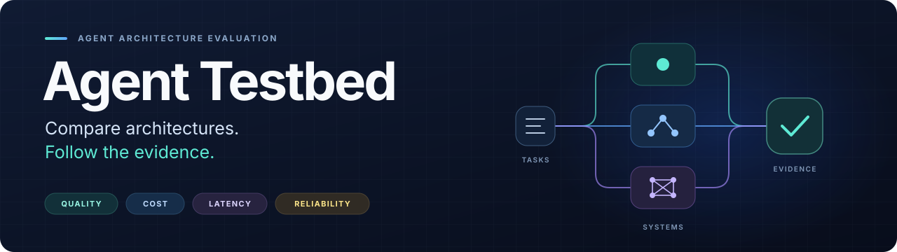

<div align="center">



### A unified evaluation framework for agent architectures

**The same tasks. The same budget. Architecture choices grounded in real outcomes.**


<p><a href="README.md">简体中文</a> · <strong>English</strong></p>

<p>
  <a href="#overview">Overview</a> ·
  <a href="#features">Features</a> ·
  <a href="#architecture">Architecture</a> ·
  <a href="#workflow">Workflow</a> ·
  <a href="#metrics">Metrics</a> ·
  <a href="#contributing">Contributing</a>
</p>

</div>

> **Project status · Runnable M2 local reliability workflow**
> Two synthetic tasks and two deterministic mock systems now execute through Inspect, receive independent scores, and persist SQLite run state with pause, cancel, orphan-worker reconnection and idempotent recovery. No real models or BB services are called. Docker isolation, real budget admission and production integration remain unfinished.

## Quick start (no real model calls)

Requires Python 3.12 and uv. Run from the repository root:

```bash
uv sync --locked --group dev
uv run agent-eval validate experiments/smoke-mock.yaml
uv run agent-eval dry-run experiments/smoke-mock.yaml
uv run agent-eval run experiments/smoke-mock.yaml
```

Expected: four completed runs; `mock-pass` passes both tasks, `mock-wrong-answer` fails both, and real model requests/tokens are zero. The CLI prints the report path. This validates engineering, not real Agent capability.

- [M2 usage and limitations (Chinese)](<docs/quickstart.md>)
- [Inspect compatibility results (Chinese)](<docs/compatibility/inspect-m0.md>)
- [Detailed development plan (Chinese)](<docs/development-plan.md>)

---

<a id="overview"></a>

## 📖 Overview

**Agent Testbed** is a unified evaluation framework for agent systems. It is designed to evaluate single-agent, planner–worker, shared-memory, blackboard-based, and autonomous multi-agent architectures under consistent tasks, tool capabilities, and resource constraints.

From **task execution → resource accounting → independent grading → comparison reports**, Agent Testbed connects the experiment into a traceable chain of evidence, helping researchers and engineering teams answer:

> **Which agent architecture works best for which tasks, and at what cost?**

Additional collaborators, shared memory, and verification stages can improve quality while introducing more calls, waiting time, and failure paths. Agent Testbed makes these trade-offs observable within the same experimental framework.

| Your question | The evaluation approach |
| :--- | :--- |
| **Which architecture should we choose?** | Compare single agents, centralized delegation, and autonomous collaboration on the same tasks and resource conditions. |
| **Which mechanisms make a difference?** | Use ablation studies to investigate shared memory, independent verification, and scheduling strategies. |
| **Is the new version actually better?** | Track quality, cost, and latency changes across models, prompts, and implementations. |
| **Was the task really completed?** | Independently verify structured answers, delivered files, and observable environment state. |
| **Can long-running tasks finish reliably?** | Examine timeouts, cancellation, service failures, recovery, and resource cleanup. |

---

<a id="features"></a>

## ✨ Core Features

<table>
<tr>
<td width="50%" valign="top">
<h3>🔌 Multiple architectures, one protocol</h3>
<p>Connect systems through <strong>Python / CLI / HTTP</strong> adapters while preserving their planning, tool loops, and collaboration logic.</p>
<p>Evaluate single-agent and multi-agent systems as complete units.</p>
</td>
<td width="50%" valign="top">
<h3>🧪 Configuration-driven comparisons</h3>
<p>Expand <strong>task suites × system configurations × repetitions</strong> into an experiment matrix, recording models, versions, tool permissions, and resources.</p>
<p>Reuse the workflow for architecture selection, ablations, and regression tracking.</p>
</td>
</tr>
<tr>
<td width="50%" valign="top">
<h3>🎯 Independent outcome grading</h3>
<p>Combine deterministic rules, hidden tests, rubrics, model-based review, and human review to evaluate answers, files, and environment changes.</p>
<p>Record <strong>execution completion, self-reported success, and external acceptance</strong> separately.</p>
</td>
<td width="50%" valign="top">
<h3>⚖️ Whole-system cost accounting</h3>
<p>Attribute calls from planners, workers, verifiers, and internal retries to the same run. Track tokens, cost, and usage completeness.</p>
<p>Controlled integrations <strong>reserve budget before calls and reconcile actual usage afterward</strong>.</p>
</td>
</tr>
<tr>
<td width="50%" valign="top">
<h3>🛡️ Isolated execution and recovery</h3>
<p>Manage workspaces, memory boundaries, timeouts, cancellation, and cleanup, with process, container, or dedicated-service environments selected per task.</p>
<p>Resume unfinished experiments through persisted state and idempotent starts.</p>
</td>
<td width="50%" valign="top">
<h3>📊 From summary to evidence</h3>
<p>Compare success rates, quality, cost, duration, and failure causes, retaining per-task results and variation across repetitions.</p>
<p>Link reports to <strong>configurations, raw traces, and artifact snapshots</strong>, with offline regrading.</p>
</td>
</tr>
</table>

---

<a id="architecture"></a>

## 🏗️ Architecture

The design combines an **established evaluation backend, a thin control layer, and pluggable adapters**. The backend provides execution, grading, and logging foundations; the control layer organizes experimental conditions and run lifecycles; adapters connect individual agent systems.


### 🤖 One System, One Run Budget

One run represents **one task × one system configuration × one repetition**. Planning, execution, verification, context summarization, and retry calls all belong to the same run identity and budget. This gives single-agent and multi-agent systems a consistent unit of comparison.

### 🔍 Public Tasks, Independent Grading

Task packages provide problems, input materials, deliverables, and environment requirements. Reference answers, hidden tests, and grading credentials stay on the evaluation side. Deterministic tests take priority, supplemented by rubrics, model-based review, or human review for open-ended quality dimensions.

Once outputs are saved as snapshots, different grader versions can evaluate them again, reusing existing execution results and preserving historical grades.

### 🚦 Execution Status and Task Success, Recorded Separately

| Recorded dimension | What it captures |
| :--- | :--- |
| **Execution status** | Normal completion, timeout, budget exhaustion, or error |
| **Self-reported status** | Claims of task completion or passing internal checks |
| **External grade** | Independent acceptance and quality scores |
| **Resource status** | Confirmation that child tasks and remote resources have stopped or been released |

“Completed normally with an incorrect answer” and “self-reported success with a failing external grade” remain explicit, analyzable outcomes.

### ⚖️ Comparisons Matched to Observability

| Integration level | Evaluation approach |
| :--- | :--- |
| **Black-box** | Submit tasks, detect completion, and collect results to assess quality and end-to-end latency. Label self-reported usage with its source and completeness. |
| **Controlled** | Attribute all model calls to a run; verify models, permissions, and budgets; validate isolation and cancellation paths for resource-constrained comparisons. |

Strict-budget experiments apply admission control before model calls: reserve capacity for concurrent requests, reconcile actual usage, and keep accounting for calls still in flight during cancellation. Reports distinguish **measured, estimated, and missing data**, with results presented separately by integration level.

---

<a id="workflow"></a>

## 🔄 Experiment Workflow

**Define tasks → Connect systems → Fix conditions → Execute → Grade independently → Compare**

| Step | What happens | Evidence retained |
| :---: | :--- | :--- |
| **01 · Define** | Prepare input materials, deliverables, and independent grading criteria | Task versions, material snapshots, grading rules |
| **02 · Connect** | Declare adapter capabilities and link model and code configurations | System identities, configurations, integration levels |
| **03 · Configure** | Set repetitions, tool permissions, budgets, environments, and concurrency | Reviewable experiment configurations and run matrix |
| **04 · Execute** | Run in isolation; record calls, state, cancellation, and cleanup | Raw traces, usage records, artifact snapshots |
| **05 · Grade** | Check answers, files, and environment state; save versioned grades | Acceptance results, quality scores, grading evidence |
| **06 · Compare** | Analyze per-task differences, variation, and failure causes | Markdown / static HTML reports, JSON / CSV data |

Experiments record memory and caching policies and distinguish **sample-level concurrency** from **concurrency within a system**. Whole-system comparisons support architecture selection; ablation studies investigate individual mechanisms.

---

<a id="tasks"></a>

## 🗂️ Evaluation Tasks

| Task type | Typical deliverables | Acceptance criteria |
| :--- | :--- | :--- |
| **🔎 Question Answering & Research** | Structured answers, findings, source citations | Reference answers, factual coverage, citation and source checks |
| **📄 File-based Delivery** | Documents, spreadsheets, analytical reports | File structure, content rules, completeness, quality rubrics |
| **💻 Environment Interaction** | Code changes, terminal tasks, observable state changes | Hidden tests, state assertions, regression checks |

**Task packages and architecture adapters evolve independently.** The same suite can evaluate multiple systems; the same system can be evaluated on business tasks and public benchmarks. Data versions, licensing information, and grader versions stay with the experiment.

---

<a id="metrics"></a>

## 📈 Evaluation Metrics

Explore architecture trade-offs across four core dimensions, supported by per-task evidence.

| Dimension | Core metrics | The question it answers |
| :--- | :--- | :--- |
| **🎯 Quality** | External success rate, task-specific scores, agreement between self-reported and external acceptance | How well was the task completed? |
| **💰 Cost** | Input / output tokens, cached usage, monetary cost, cost per successful run | What does a useful result cost? |
| **⏱️ Latency** | End-to-end duration; preparation / queue / execution / collection / grading timings | Where is time spent? |
| **🛡️ Reliability** | Timeout, budget-exhaustion, and infrastructure error rates; recovery and cleanup | Can the system finish safely when something goes wrong? |

> **Every finding has an evidence trail.** Reports link per-task results, variation across repetitions, failure causes, and data gaps back to individual runs.

<details>
<summary><strong>View statistical and cost accounting conventions</strong></summary>

- Statistics cover successful and failed runs, retaining all consumption from internal retries.
- Cost per successful run = total execution cost ÷ externally verified successes; it is marked unavailable when there are no successes.
- External grading and control-layer overhead are accounted for separately and included in total experiment expenditure.
- Analysis uses task-level paired comparisons, variation across repetitions, and confidence intervals.
- Models, budgets, resources, integration levels, and data completeness are disclosed alongside the results.

</details>

---

<a id="extensibility"></a>

## 🧩 Extensible by Design

**Add an adapter for a new architecture, a task package for a new task, and a grader for a new acceptance method.**

Core contracts separate tasks, systems, execution, and grading. The evaluation core maintains a consistent experimental workflow and accounting model.

<details>
<summary><strong>View core contracts and the adapter lifecycle</strong></summary>

| Object | Responsibility |
| :--- | :--- |
| `TaskSpec` | Agent-visible problem, materials, deliverables, and environment requirements |
| `GradingSpec` | Evaluation-side reference answers, hidden tests, rules, and grader versions |
| `SystemSpec` | Architecture identity, adapter, model and prompt configuration, code version, and capabilities |
| `RunConfig` | Per-run budget, timeout, resources, and repetition identifier |
| `RunResult` | Execution status, answer, artifacts, traces, usage, and self-reported status |
| `ScoreResult` | Acceptance results, quality scores, and evidence from independent graders |

Adapters declare observability and control through `capabilities` and manage the run lifecycle through `start`, `poll`, `cancel`, `collect`, and `cleanup`.

Stable run identities and idempotent starts support state reconciliation and recovery after interruptions. Cancellation requests, actual termination, and cleanup are confirmed separately; partial artifacts can also be collected after failure or cancellation.

</details>

---

<a id="contributing"></a>

## 🤝 Contributing

Help build agent evaluation around real deliverables:

- **System integrations**: agent adapters and minimal integration examples.
- **Tasks and graders**: reproducible packages, deterministic tests, and quality rubrics.
- **Execution reliability**: usage metering, budget control, isolation, and recovery tests.
- **Analysis and documentation**: comparison reports, trace analysis, and Chinese and English guides.

Please include source, version, and licensing information with tasks or datasets. Use sanitized examples to demonstrate integrations involving sensitive materials.

## 📄 License

This project is licensed under the [Apache License 2.0](<LICENSE>). Third-party task suites, datasets, and dependencies retain their respective licenses.

---

<div align="center">
<strong>Compare architectures. Follow the evidence.</strong><br />
<sub>Make architecture choices with experimental evidence.</sub>
</div>
