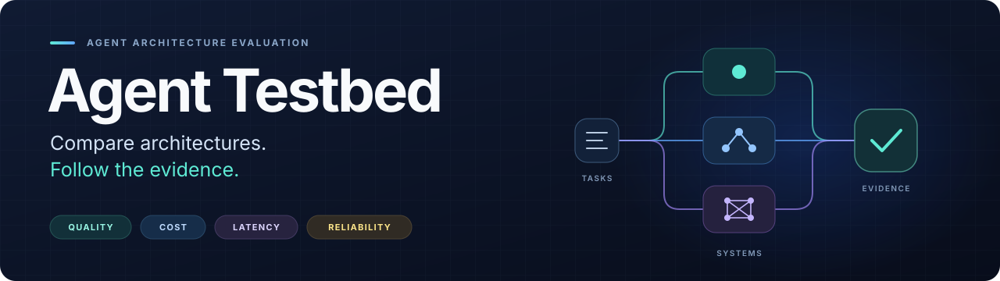

### 面向 Agent 架构的统一评测框架

**同一套任务，同一份预算，让架构价值体现在真实交付中。**

<strong>简体中文</strong> · <a href="README.en.md">English</a>

  <a href="#overview">项目简介</a> ·
  <a href="#features">核心特性</a> ·
  <a href="#architecture">系统架构</a> ·
  <a href="#workflow">实验流程</a> ·
  <a href="#metrics">评测指标</a> ·
  <a href="#contributing">参与贡献</a>

> **项目状态 · 早期开发**
> 本文展示产品设计与目标能力。实现、接入示例和使用文档将随版本逐步完善。

---

## 📖 项目简介

**Agent Testbed** 是一个面向 Agent 系统的统一评测框架，旨在让单 Agent、planner–worker、共享记忆、黑板协作和自主多 Agent 等架构，在一致的任务、工具能力和资源约束下接受评测。

从**任务执行 → 资源计量 → 独立评分 → 对比报告**，Agent Testbed 将整个实验过程串成可追溯的证据链，帮助研究者和工程团队回答：

> **什么样的 Agent 架构，适合什么样的任务，代价又是多少？**

增加协作角色、共享记忆或核验环节，可能改善质量，也可能引入额外调用、等待与故障路径。Agent Testbed 将这些取舍放在同一套实验中观察。

| 你关心的问题 | Agent Testbed 的评测方式 |
| :--- | :--- |
| **架构怎么选？** | 在同一任务集与资源条件下，对比单 Agent、集中式派工和自主协作。 |
| **哪个机制有帮助？** | 通过消融实验，分析共享记忆、独立核验和调度策略的贡献。 |
| **新版本真的更好吗？** | 跟踪模型、提示词和实现变化带来的质量、成本与时延差异。 |
| **任务是否真正完成？** | 使用结构化答案、交付文件与环境状态进行独立验收。 |
| **长任务是否可靠？** | 观察超时、取消、服务异常、恢复与资源回收过程。 |

---

## ✨ 核心特性

<table>
<tr>
<td width="50%" valign="top">
<h3>🔌 多架构，一套接入协议</h3>

通过 <strong>Python / CLI / HTTP</strong> 适配器连接不同系统，保留各自的规划、工具循环和协作逻辑。

从单 Agent 到多 Agent，以完整系统作为统一评测单位。

</td>
<td width="50%" valign="top">
<h3>🧪 配置驱动，批量对照</h3>

将<strong>任务集 × 系统配置 × 重复次数</strong>展开为实验矩阵，统一记录模型、版本、工具权限和资源条件。

面向架构选型、机制消融和持续回归复用同一流程。

</td>
</tr>
<tr>
<td width="50%" valign="top">
<h3>🎯 独立评分，检验交付</h3>

组合确定性规则、隐藏测试、质量量表、模型评审与人工复核，评价答案、文件和环境变化。

<strong>执行结束、系统自报成功、外部验收通过</strong>分别记录。

</td>
<td width="50%" valign="top">
<h3>⚖️ 全局计量，看清代价</h3>

将规划者、执行者、核验者和内部重试的模型调用归集到同一次运行，追踪 token、费用与用量完整性。

受控接入下采用<strong>调用前预留、执行后结算</strong>的预算机制。

</td>
</tr>
<tr>
<td width="50%" valign="top">
<h3>🛡️ 隔离执行，可靠恢复</h3>

管理独立工作区、记忆边界、超时、取消与资源清理，按任务配置进程、容器或专用服务环境。

以持久化状态和幂等启动协议，继续未完成的实验。

</td>
<td width="50%" valign="top">
<h3>📊 从汇总结果回到证据</h3>

对比成功率、质量、成本、耗时和失败原因，保留逐题结果与重复运行波动。

报告关联<strong>配置、原始轨迹与产物快照</strong>，支持离线重评分。

</td>
</tr>
</table>

---

## 🏗️ 系统架构

设计采用 **成熟评测底座 + 薄控制层 + 可插拔适配器**。底座承载执行、评分与日志能力；控制层组织实验条件和运行生命周期；适配器连接具体的 Agent 系统。

### 🤖 整个系统，一份运行预算

一次运行对应 **一个任务 × 一个系统配置 × 一次重复**。系统内部的规划、执行、核验、摘要压缩和重试调用，都归属于同一个运行标识和预算。单 Agent 与多 Agent 因此拥有一致的比较单位。

### 🔍 任务公开，评分独立

任务包提供题目、输入资料、交付要求与环境需求；标准答案、隐藏测试和评分凭据由评测侧独立管理。评分优先采用确定性测试，对开放式质量项补充量表、模型评审或人工复核。

交付结果保存为快照后，可以使用不同版本的评分器重新验收，复用已有执行结果并保留历史评分记录。

### 🚦 运行状态与任务成功分层记录

| 记录维度 | 关注的结果 |
| :--- | :--- |
| **执行状态** | 是否正常结束、超时、超预算或出错 |
| **系统自报** | 是否声称完成任务或通过内部验收 |
| **外部评分** | 是否满足独立标准，以及各项质量分 |
| **资源状态** | 子任务与远程资源是否已停止或清理 |

“正常结束但答案错误”和“自报通过但外部验收失败”都会作为可分析的结果保留。

### ⚖️ 按可观测能力组织比较

| 接入等级 | 评测方式 |
| :--- | :--- |
| **黑盒接入 · Black-box** | 提交任务、识别结束、收集结果，评价交付质量与端到端耗时；系统自报用量标注来源和完整性。 |
| **受控接入 · Controlled** | 将所有模型调用归属到运行，核对模型、权限与预算，验证隔离和取消路径，开展资源约束下的架构对照实验。 |

严格预算实验在模型调用前实施准入控制：并发请求先预留额度，再结算实际用量，并继续追踪取消时的在途调用。报告区分**实测、估算与缺失数据**，并分别呈现不同接入等级的结果。

---

## 🔄 实验流程

**定义任务 → 接入系统 → 固定条件 → 执行实验 → 独立评分 → 对比分析**

| 步骤 | 主要工作 | 留下的证据 |
| :---: | :--- | :--- |
| **01 · 定义任务** | 准备输入资料、交付要求与独立评分标准 | 任务版本、资料快照、评分规则 |
| **02 · 接入系统** | 通过适配器声明能力，关联模型与代码配置 | 系统身份、配置与接入等级 |
| **03 · 固定条件** | 设置重复次数、工具权限、预算、环境和并发 | 可复核的实验配置与运行矩阵 |
| **04 · 执行实验** | 隔离运行，记录调用、状态、取消与清理结果 | 原始轨迹、用量和产物快照 |
| **05 · 独立评分** | 检查答案、文件和环境状态，保存版本化评分 | 验收结果、质量分和评分证据 |
| **06 · 对比分析** | 汇总逐题差异、运行波动与失败原因 | Markdown / 静态 HTML 报告、JSON / CSV 数据 |

实验记录记忆与缓存策略，并区分**样本级并发**和**系统内部并发**。完整系统对比用于选择方案；消融实验用于分析具体机制的贡献。

---

## 🗂️ 评测任务

| 任务类型 | 典型交付 | 验收依据 |
| :--- | :--- | :--- |
| **🔎 问答与研究** | 结构化答案、研究结论、引用来源 | 标准答案、事实覆盖、引用与来源检查 |
| **📄 文件交付** | 文档、表格、分析报告 | 文件结构、内容规则、完整性与质量量表 |
| **💻 环境操作** | 代码修改、终端任务、环境状态变化 | 隐藏测试、状态断言与回归检查 |

**任务包与架构适配器独立演进。** 同一任务集可以评测多个系统，同一系统也可以用于不同业务任务与公开评测集。数据版本、授权与评分器版本随实验保留。

---

## 📈 评测指标

从四个核心维度观察架构价值，并用逐题证据解释结果。

| 维度 | 核心指标 | 帮助回答 |
| :--- | :--- | :--- |
| **🎯 质量 · Quality** | 外部成功率、任务质量分、自报与外部验收一致性 | 任务完成得怎么样？ |
| **💰 成本 · Cost** | 输入 / 输出 token、缓存用量、费用、每个成功运行的成本 | 获得有效结果需要多少投入？ |
| **⏱️ 时延 · Latency** | 端到端耗时、准备 / 排队 / 执行 / 收集 / 评分阶段耗时 | 时间花在哪里？ |
| **🛡️ 可靠性 · Reliability** | 超时率、超预算率、基础设施错误率、恢复与清理表现 | 遇到异常时能否稳定收尾？ |

> **每个结论都有出处。** 报告关联逐题结果、重复运行波动、失败原因、数据缺口与证据索引，从汇总指标追溯到单次运行。

<strong>查看统计与成本口径</strong>

- 统计覆盖成功与失败运行，保留内部重试的全部消耗。
- 每个成功运行的成本 = 全部执行成本 ÷ 外部成功数；成功数为零时标记为不可计算。
- 外部评分与控制层开销单独记账，同时纳入整场实验总投入。
- 分析采用任务级配对比较，结合重复运行波动和置信区间呈现差异。
- 模型、预算、资源投入、接入等级与数据完整性作为结果的解释条件一并披露。

---

## 🧩 可扩展设计

**新架构接适配器，新任务写任务包，新验收方式加评分器。**

核心协议将任务、系统、执行和评分解耦，评测核心维持统一的实验流程与数据口径。

<strong>查看核心对象与适配器生命周期</strong>

| 对象 | 职责 |
| :--- | :--- |
| `TaskSpec` | 被测系统可见的题目、资料、交付要求和环境需求 |
| `GradingSpec` | 评测侧管理的标准答案、隐藏测试、规则和评分版本 |
| `SystemSpec` | 架构身份、适配器、模型与提示词配置、代码版本和能力声明 |
| `RunConfig` | 单次运行的预算、超时、资源与重复编号 |
| `RunResult` | 执行状态、回答、产物、轨迹、用量和系统自报状态 |
| `ScoreResult` | 独立评分器产生的验收结果、质量分与证据 |

适配器通过 `capabilities` 声明可观测与控制能力，围绕 `start`、`poll`、`cancel`、`collect` 和 `cleanup` 管理运行生命周期。

稳定的运行身份与幂等启动协议支持中断后的状态核对和恢复。取消请求、实际终止与资源回收分别确认，失败或取消时的部分产物也可以收集。

---

## 🤝 参与贡献

欢迎一起建设面向真实交付的 Agent 评测工具：

- **系统接入**：Agent 适配器与最小接入示例。
- **任务与评分**：可复现任务包、确定性测试和质量量表。
- **执行可靠性**：用量计量、预算控制、隔离与故障恢复测试。
- **分析与文档**：对比报告、轨迹分析和中英文使用文档。

任务包或数据请附上来源、版本与授权说明；涉及敏感资料时，可用脱敏样例展示接入方式。

## 📄 许可证

本项目采用 [Apache License 2.0](<LICENSE>)。第三方任务集、数据与依赖遵循各自的许可条款。

---

<strong>Compare architectures. Follow the evidence.</strong> 
让架构选择有实验依据。

